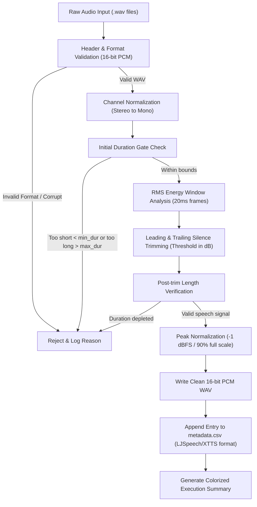

# 🎙️ audio-dataset-cleaner

> **Topics:** `voice-cloning` `xtts-v2` `rvc` `audio-processing` `speech-dataset` `silence-trimming` `lufs-normalization` `text-to-speech`


[](https://github.com/shadialhasan/audio-dataset-cleaner/releases/tag/v1.0.0)
[](LICENSE)
[](https://python.org)
[](https://github.com/shadialhasan/audio-dataset-cleaner/actions)
[](https://github.com/shadialhasan)

A production-grade Python CLI utility designed to automate the cleaning, silence trimming, peak normalization, and metadata generation for voice datasets targeting **Coqui XTTS-v2, RVC (Retrieval-based Voice Conversion), and VITS**.

---

## 📐 Architecture & Processing Pipeline



---

## ⚡ Key Features

- **Automated Silence Trimming**: Energy-based thresholding trims leading and trailing dead silence while preserving speech dynamics.
- **Stereo to Mono Downmixing**: Automatically detects 2-channel stereo audio and synthesizes balanced mono waveforms.
- **Peak & RMS Normalization**: Normalizes audio levels to -1 dBFS to prevent clipping and gradient instability during model fine-tuning.
- **Duration Filtering**: Automatically filters out audio fragments that are too short (<1s) or too long (>12s) to stabilize model attention matrices.
- **Standardized Metadata Export**: Automatically generates `metadata.csv` compliant with LJSpeech and XTTS formatting.
- **Colorized CLI Logging**: Real-time terminal feedback with ANSI coloring and diagnostic error tracking.
- **Flexible Configuration**: Supports `.env` environment variables and `config.json` files alongside command-line arguments.
- **Zero Heavy Dependency Mode**: Built on top of Python's standard library (`wave`, `struct`, `math`) with optional NumPy/SciPy acceleration.

---

## 🚀 Quick Start

### 1. Installation

```bash
git clone https://github.com/shadialhasan/audio-dataset-cleaner.git
cd audio-dataset-cleaner
pip install -r requirements.txt
```

### 2. Configuration

Copy the example environment or configuration template:

```bash
cp .env.example .env
# or customize config.json
```

**Configuration via `config.json`**:
```json
{
  "target_sr": 22050,
  "silence_thresh_db": -40.0,
  "min_duration": 1.0,
  "max_duration": 12.0,
  "input_dir": "raw_audio",
  "output_dir": "dataset_clean",
  "norm_peak_ratio": 0.9,
  "window_size_ms": 20
}
```

### 3. Execution

Place raw `.wav` recordings in your input folder (e.g. `raw_audio/`), then run:

```bash
python audio_cleaner.py --input raw_audio --output dataset_clean --threshold -40 --min-dur 1.2 --max-dur 11.5
```

---

## ⚙️ Operational Flags & Options

| Flag | Short | Type | Default | Description |
|---|---|---|---|---|
| `--input` | `-i` | String | `raw_audio` | Path to directory containing raw WAV audio files |
| `--output` | `-o` | String | `dataset_clean` | Destination directory for sanitized audio and metadata |
| `--threshold` | `-t` | Float | `-40.0` | Silence detection threshold in decibels relative to full scale (dBFS) |
| `--min-dur` | | Float | `1.0` | Minimum allowed audio duration in seconds (shorter rejected) |
| `--max-dur` | | Float | `12.0` | Maximum allowed audio duration in seconds (longer rejected) |
| `--norm-peak` | | Float | `0.9` | Target peak ratio for normalization (0.9 ≈ -1 dBFS) |
| `--config` | `-c` | String | `config.json` | Path to JSON configuration file |
| `--env-file` | | String | `.env` | Path to environment variable overrides file |
| `--no-color` | | Flag | `False` | Disable ANSI color codes in console output |

---

## 🧪 Automated Testing

The project includes a comprehensive automated test suite testing RMS math, silence trimming, stereo conversion, duration rejection, corrupt header handling, and metadata manifest creation.

Run tests locally:
```bash
python -m unittest discover -s tests -v
```

---

## 👤 Author & Maintainer

**Eng. MHD. Shadi AL-Hasan**  
- **Role:** Executive CTO & Enterprise Solutions Architect  
- **Email:** [mhd.shadi.alhasan@gmail.com](mailto:mhd.shadi.alhasan@gmail.com)  
- **Phone / WhatsApp:** [+963934005922](tel:+963934005922)  
- **Location:** Damascus, Syria  
- **GitHub:** [shadialhasan](https://github.com/shadialhasan)  

---

## 📄 License

This project is licensed under the MIT License - see the [LICENSE](LICENSE) file for details.  
Copyright (c) 2026 **MHD. Shadi AL-Hasan**. All rights reserved.